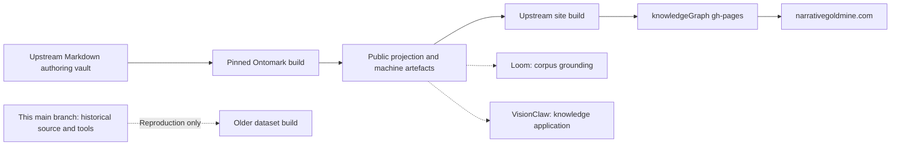

<div align="center">

# Narrative Goldmine

### The public corpus distribution for the VisionFlow estate

[Read the corpus](https://narrativegoldmine.com/) · [Explore](https://narrativegoldmine.com/graph/) · [Consume the data](#consume-the-public-data) · [Architecture](#how-publication-works) · [Status](#working-status) · [Licences](LICENSING.md)

</div>


**knowledgeGraph is the publication target and historical archive for Narrative Goldmine.** It hosts the public Markdown corpus and compiled ontology at [narrativegoldmine.com](https://narrativegoldmine.com/). Authoring and the active publication build live upstream; this checkout's `main` branch retains the earlier corpus, pipeline, explorer and their method.

Use the public site to read concepts, explore their relationships or download machine-readable artefacts. Use [Ontomark](https://github.com/DreamLab-AI/ontomark) to build a new corpus from Markdown. Running the archived Python pipeline here reproduces an older dataset; it does not rebuild today's public site.

The corpus is substantially **synthetic, generated under human direction**. It is a testbed for ontology tooling, graph exploration and grounding, not an authoritative encyclopaedia. Provenance records generation and attribution; it does not establish that every source assertion is true.

## Consume the public data

For a first look, open [the site](https://narrativegoldmine.com/) and [graph explorer](https://narrativegoldmine.com/graph/). For a script, begin with the published statistics rather than a count copied from a README:

```sh
curl -fL https://narrativegoldmine.com/data/graph/stats.json -o stats.json
curl -fL https://narrativegoldmine.com/ns/v2.jsonld -o context.jsonld
```

`stats.json` describes a dataset snapshot. Read its date and schema fields along with its counts; a stable `pipelineVersion` string alone does not identify a generation. The JSON-LD namespace document supplies the vocabulary mappings used by the published artefacts.

| Published observation | Value |
|---|---:|
| Dataset date | 20 October 2026 |
| Classes | 9,532 |
| Pages | 9,530 |
| Individuals | 0 |
| Domains / categories | 9 / 68 |

These values were fetched on **21 October 2026** from [the public statistics endpoint](https://narrativegoldmine.com/data/graph/stats.json). They are not counts of this checkout's archived source and will change as new generations are published. Classes and pages are distinct fields; do not substitute one for the other.

The observed export describes a class-based ontology with no individuals. Runtime systems can populate their own graphs with instances and activity; those runtime datasets are separate from this public export.

## How publication works



[Ontomark](https://github.com/DreamLab-AI/ontomark) owns the shared parser, model, reasoner and compiler. Its public and machine projections have explicit contracts. Publishing a public site does not imply that every runtime consumer has upgraded to the same compiler or loaded the same generation.

The repository's former seven-stage rdflib build and Logseq-format source were retired in September 2026. Their old instructions remain useful for reproduction, with their paths and dates made explicit below. The `main` branch has no active repository-root corpus-build workflow; the preserved workflow is under [`archive/github-workflows/`](archive/github-workflows/).

## What is in this checkout

| Path | Purpose |
|---|---|
| [`archive/logseq-era-2026-09-22/`](archive/logseq-era-2026-09-22/README.md) | Earlier Logseq corpus and Python publication pipeline |
| [`archive/github-workflows/`](archive/github-workflows/) | Retired workflow; historical build and gate definitions |
| [`dist/data/`](dist/data/) | Committed historical Turtle, WebVOWL JSON and graph artefacts |
| [`static/ns/v2.jsonld`](static/ns/v2.jsonld) | Local namespace document; distinguish it from the current served version |
| [`explorer/`](explorer/) | Retained React/Rust/WASM explorer implementation |
| [`explorer/FORMAT-NGG1.md`](explorer/FORMAT-NGG1.md) | Local binary format documentation |
| [`explorer/CAPABILITIES.md`](explorer/CAPABILITIES.md) | Explorer capability record and its evidence limits |
| [`docs/`](docs/) | Architecture, methodology and historical acceptance records |

<details>
<summary><strong>Reproduce the archived Python dataset</strong></summary>

Use the preserved source tree explicitly. This is a historical reproduction path, not a deployment command or the current authoring workflow.

```sh
git clone https://github.com/DreamLab-AI/knowledgeGraph.git
cd knowledgeGraph/archive/logseq-era-2026-09-22
python3 -m venv .venv
. .venv/bin/activate
pip install 'rdflib>=7.0.0'
python -m pipeline.build pages dist-reproduced
```

The committed [`dist/data/graph/stats.json`](dist/data/graph/stats.json) at `main` records the **7 August 2026** dataset: 8,138 classes, 8,134 pages, zero individuals, six domains and 34 categories. It is separate from the public snapshot above. Historical validation results and timings describe that input and implementation, not the current export. Reproduction may differ in serialisation or timestamps; compare the appropriate semantic data rather than assuming every output byte is deterministic.

The earlier representation puts machine assertions in fenced JSON-LD and readable content in Markdown. The current authoring toolchain uses typed frontmatter. Do not apply the old `public::` / embedded-JSON rules to a current vault without following its profile.

</details>

<details>
<summary><strong>Explorer and graph-format boundaries</strong></summary>

The retained explorer has its own build and acceptance record. Its presence here does not establish that the upstream publisher deploys this exact copy. Consult [`explorer/CAPABILITIES.md`](explorer/CAPABILITIES.md) and [`docs/architecture/explorer.md`](docs/architecture/explorer.md) before reusing it.

NGG1 represents graph tiers with a compact node table and CSR adjacency. The local format uses 24-byte node records and stores one category per node; it cannot by itself represent every multiple-inheritance membership. Sidecar metadata carries additional memberships. Check the producer and consumer versions together before using a binary tier.

Historical worker-transport and performance findings are bounded by their source revisions. A successful page fetch does not establish GPU layout, interaction performance or acceptance of every explorer feature.

</details>

## Where it sits in VisionFlow

| Project | Relationship |
|---|---|
| [VisionFlow](https://github.com/DreamLab-AI/VisionFlow) | Ecosystem architecture, compatibility map and cross-repository diagrams |
| [Ontomark](https://github.com/DreamLab-AI/ontomark) | Current shared compilation and reasoning toolchain |
| [Ontomark for Obsidian](https://github.com/DreamLab-AI/ontomark-obsidian) | Local authoring and reviewed frontmatter edits; independently pinned engine |
| [Loom](https://github.com/DreamLab-AI/loom) | Serves corpus-derived retrieval and model context; research results retain their evaluation scope |
| [VisionClaw](https://github.com/DreamLab-AI/VisionClaw) | Knowledge graph and spatial application; independent runtime state and acceptance |
| [Agentbox](https://github.com/DreamLab-AI/agentbox) | Agent runtime and configured corpus tools |

Sibling products own their runtime claims. This repository distributes data; it does not certify every model answer, governance decision or downstream deployment.

## Working status

**Reviewed 21 October 2026 at `main` revision `4ed9ac159d`.** The `main` branch is a retained archive and tooling snapshot; the public `gh-pages` output can advance independently.

The public statistics endpoint was fetched successfully for this review. No complete upstream publishing run, fresh archived build, installed explorer interaction or live cross-estate session was verified. The [diagram corpus](https://github.com/DreamLab-AI/VisionFlow/tree/main/docs/diagrams/knowledgegraph) describes this repository at declared revisions and records the archive boundary.

For changes to published concepts, use the owning authoring workflow and its human review process. For changes to this archive or retained tooling, read [CONTRIBUTING.md](CONTRIBUTING.md), identify the affected generation and state which checks you ran.

## Licences and credit

This repository has distinct licence scopes: **ODbL-1.0** for corpus/database material, **MIT** for the retained explorer, and **AGPL-3.0-or-later** for the original pipeline and applicable prose/glue. [`LICENSING.md`](LICENSING.md) is the authoritative path mapping; [`NOTICE`](NOTICE) records upstream attribution. A root licence badge cannot describe all three.

The explorer retains the WebVOWL lineage and notices. Maintained by DreamLab AI; terms for alternative use are described in [`COMMERCIAL.md`](COMMERCIAL.md). The decorative hero image illustrates a graph; it is not a capture or measurement of the current corpus.
